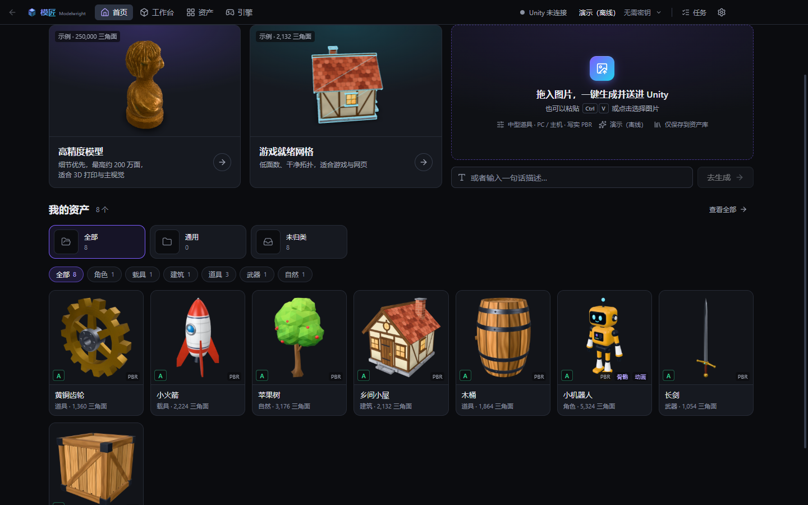
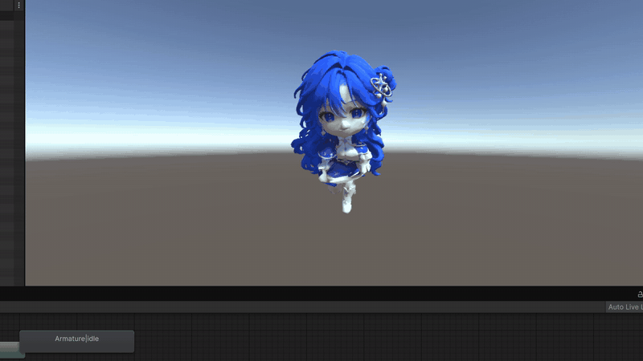
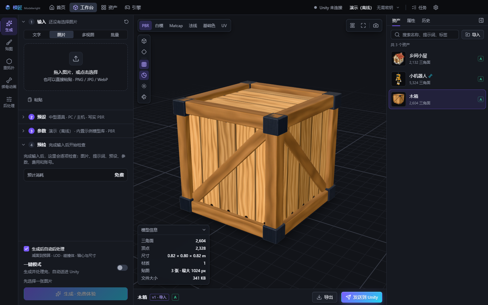
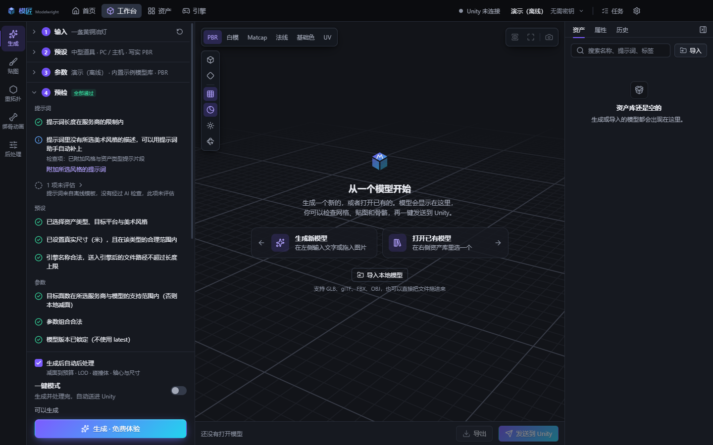
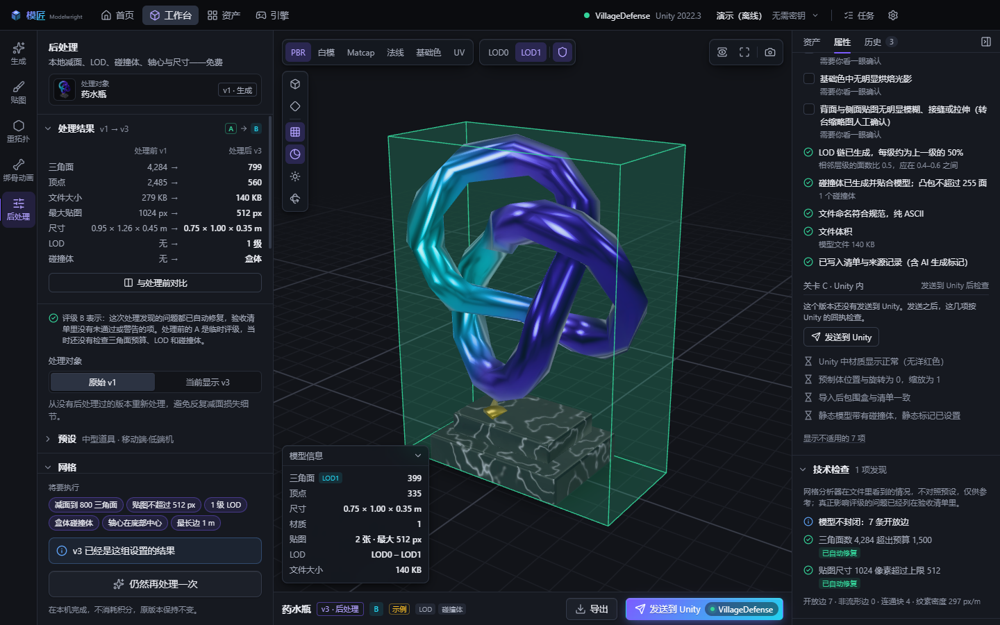
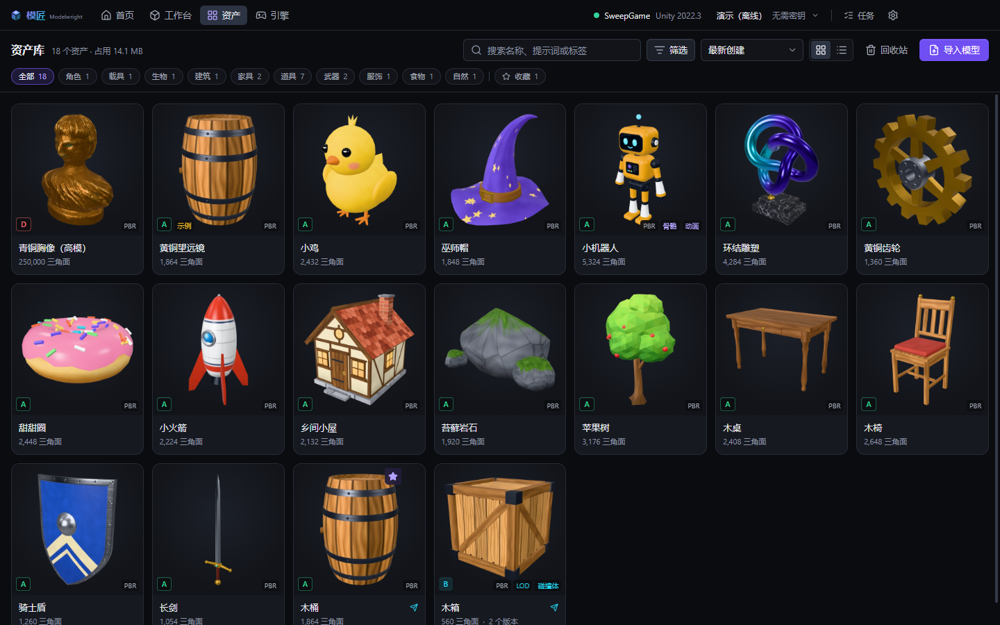
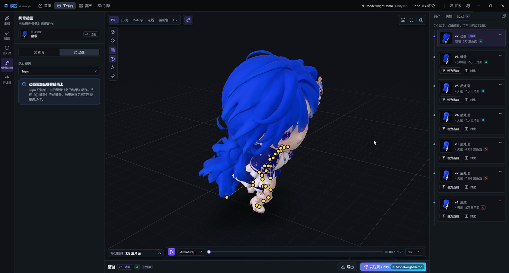
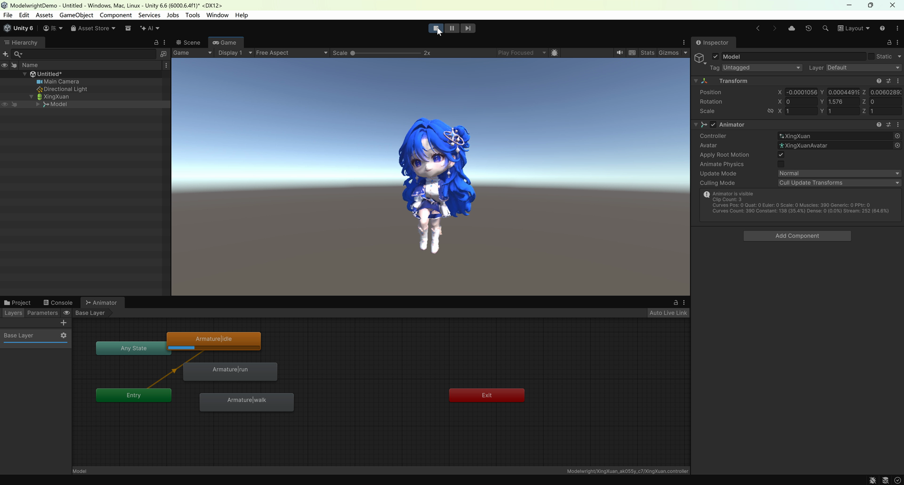

<h3 align="center">
  <a href="README.md">简体中文</a> &nbsp;|&nbsp; English &nbsp;|&nbsp; <a href="README.ja.md">日本語</a>
</h3>

  

<h1 align="center">Modelwright</h1>

<b>One image or one sentence in, a 3D model out — sent to Unity in one click.</b>

  <a href="https://github.com/chenyihang98-pixel/Modelwright/releases/latest">Download</a> ·
  <a href="https://www.bilibili.com/video/BV1YqpZ6kEw4">Demo video</a> ·
  <a href="RELEASE-NOTES.en.md">Changelog</a> ·
  <a href="https://chenyihang98-pixel.github.io/Modelwright/en/">Website</a>

  
  

A model fresh out of an AI generator is rarely ready to use: too many polygons, no LODs, no colliders, the wrong size and pivot, and you still have to drag it into the engine and build materials and a prefab by hand. Modelwright strings all of that together — generate, decimate, rig, animate, send to Unity — in one window.

It's free. Generation runs in the cloud with your own API key (Tripo, Meshy or Tencent Hunyuan), so there are no model weights to download. No key yet? The built-in demo provider lets you walk through the whole flow first.

Windows 10 / 11. Unity is the only engine supported for now.

## Demo

Two short videos on bilibili (Chinese captions, mostly screen recording):

- [Episode 2](https://www.bilibili.com/video/BV1YqpZ6kEw4) — rig a character, add three motions, send it into Unity
- [Episode 1](https://www.bilibili.com/video/BV1VMHU6mEQt) — a 192 × 208 sprite becomes a 3D character standing in a Unity scene

## Download

Grab the latest version from [Releases](https://github.com/chenyihang98-pixel/Modelwright/releases/latest). Pick any one of the three:

| File | |
|---|---|
| `Modelwright-Setup-…-x64.exe` | Installer, recommended. Updates itself when a new version is out |
| `Modelwright-Portable-…-x64.exe` | Portable, a single file. Data lives in a `Modelwright-Data` folder next to it, so it can travel on a USB stick |
| `Modelwright-…-win.zip` | Unzip and run |

The installer isn't code-signed, so Windows will stop you once on first run: click "More info → Run anyway". If you'd rather check, the SHA-256 of every file is on the release page.

## What it does

- **Generate**: image or text to 3D. Turnaround sheets with three or four views are split automatically, and a single front view can be turned into four views first
- **Check before you pay**: you see roughly how many credits a job will cost before it is submitted, and problems with the image or the settings are flagged up front
- **Local post-processing**: decimation, LODs, colliders, pivot and size, all done in one go from an "asset type × target platform" preset. Costs no credits
- **Rigging and motions**: rig in the cloud; tune idle, walk, run and jump yourself in the Motion studio, or import Mixamo clips; drive the character around in the Playground and the Range to see how it holds up
- **Into Unity**: with the plugin installed, one click builds the materials, the prefab (with LODs and colliders) and the Animator, and drops the model into the scene
- **Asset library**: version history, folders, search, a recycle bin, export to GLB / OBJ / STL / PLY
- **Batch**: one description per line; jobs queue up for generation, processing and delivery, and survive closing the app

The UI is Chinese by default. Switch to English under Settings → Language & about.

## Screenshots

| | |
|---|---|
|  |  |
| Workspace | Checks and cost before submitting |
|  |  |
| Local post-processing, before and after | Asset library |
|  |  |
| Rigging and motions | Play mode in Unity |

## Getting started

1. Install and open it, then pick a 3D provider in the welcome guide. Without a key, choose "Demo (offline)": it returns built-in sample models, enough to learn the flow.
2. On the Home page, drop an image in or type a description.
3. The result shows up under Assets. Open it in the Workspace to inspect the mesh and textures, post-process, rig, or send it to Unity.

### API keys

Enter them under Settings → 3D providers.

| Provider | Where to get a key | Notes |
|---|---|---|
| Tripo | [Global](https://developers.tripo3d.ai) / [China](https://developers.tripo3d.com) | Recommended. The two regions have separate accounts and credits; each has its own field in Settings |
| Meshy | [meshy.ai](https://www.meshy.ai/developers/keys) | Needs a Pro subscription; keys from free accounts are rejected |
| Tencent Hunyuan 3D | [TokenHub](https://console.cloud.tencent.com/tokenhub/apikey) | Needs a Tencent Cloud account. Enable the HY-3D models, then create an `sk-` key in the Guangzhou region. The app has a guide with screenshots |

Concept images and prompt polishing are optional: set them up under Settings → Images & prompts. OpenAI-compatible endpoints, Gemini, Anthropic and DeepSeek all work.

Keys stay on your own computer, encrypted by Windows. Modelwright has no server and collects nothing.

Generation spends the credits in your own provider account. The estimated cost is shown before you submit, anything above your own limit asks for one more confirmation, and a request that costs credits is never sent twice on its own.

## Connecting Unity

Works with Unity 2022.3, Unity 6 and Tuanjie, on Built-in, URP and HDRP.

Add your project on the Engine page, click "Install plugin", and from then on just hit "Send to Unity" on any asset. With the editor open the import happens right away: materials, prefab, LODs and colliders are built and the model is placed in the scene. A character with motions gets its Animator wired up — press Play and it moves.

Sending works without the plugin too; the files simply land in `Assets/Modelwright/` and Unity does its default import. If the project has no glTF importer, you'll be asked whether to install glTFast (free, recommended).

## Known issues

- Windows only, Unity only
- Mostly tested on Unity 6. Unity 2022.3 and Tuanjie have seen far less testing — please open an issue if something breaks
- Cloud motion files from Tencent Hunyuan come out with torn skinning in Unity; the files themselves are at fault. For a character rigged by Hunyuan, add motions with "Complete base motions (local)" in the Motion studio instead
- Motion studio clips are procedural, not mocap. Fine for prototypes and play tests; import Mixamo clips when you want something more natural
- No cloth simulation for skirts or hair, so a skirt may clip through the legs when running
- Rigged models can't be decimated or given LODs locally
- Background removal uses a small local model. Busy backgrounds can leave fringes; clean them up by hand in the image editor
- Provider download servers are slow at times. If a download fails, click "Retry" in the task queue — you won't be charged again

## Where your data lives

| | Installer | Portable |
|---|---|---|
| Asset library | `Documents\Modelwright`, can be moved in Settings | `Modelwright-Data\Library` |
| Settings, keys, logs | `%APPDATA%\Modelwright` | `Modelwright-Data` |

Settings → Asset library → "Where files live" shows how much each place takes and clears caches in one click. The uninstaller asks whether to remove your data as well.

## Feedback

Bugs and ideas go to [Issues](https://github.com/chenyihang98-pixel/Modelwright/issues). Include the version and the steps, and attach the log if you can (Settings → Language & about → "Open the log folder"; it contains no keys).

## License

Modelwright is free to use. It is not open source and the source code is not public — see the [license](LICENSE-en.txt). Third-party components are listed in [THIRD-PARTY-NOTICES.txt](THIRD-PARTY-NOTICES.txt).
