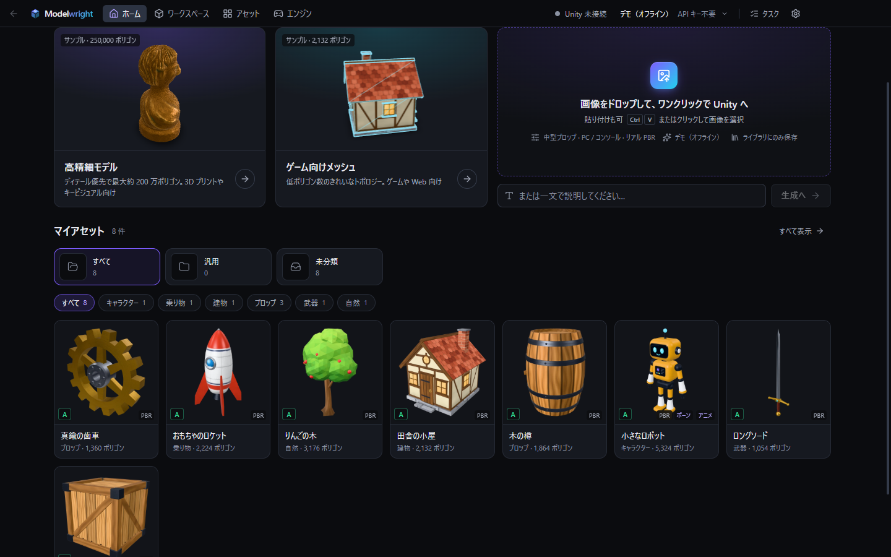
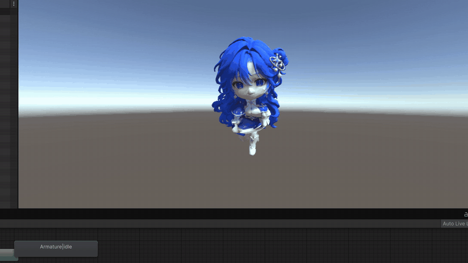
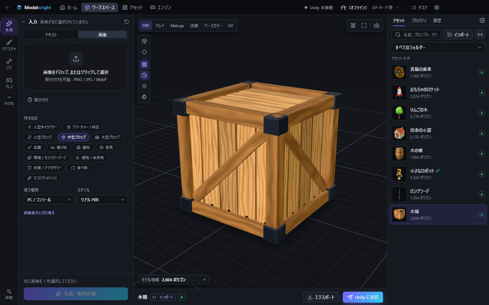
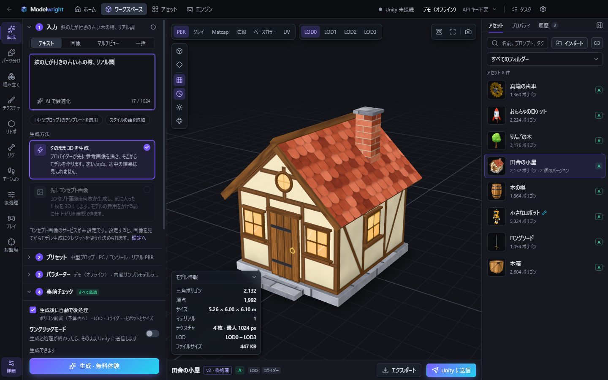
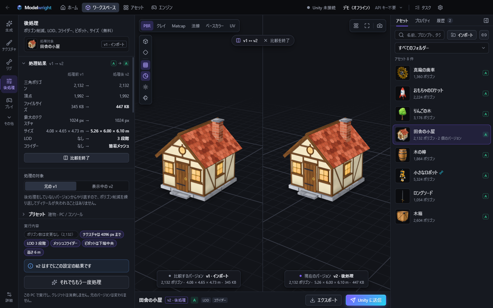
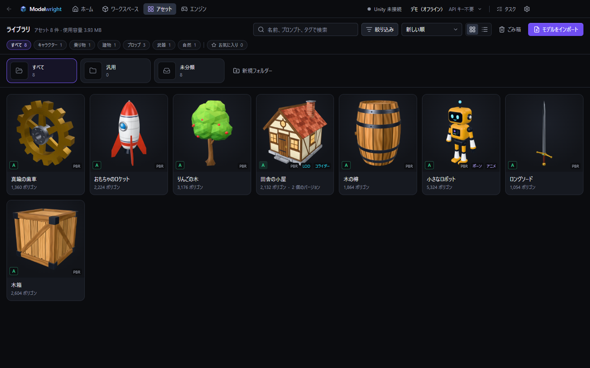
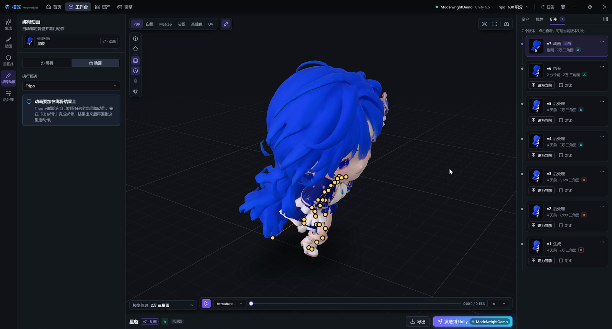
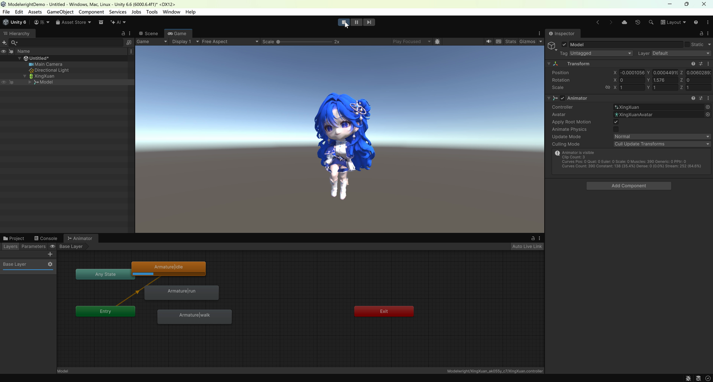

<h3 align="center">
  <a href="README.md">简体中文</a> &nbsp;|&nbsp; <a href="README.en.md">English</a> &nbsp;|&nbsp; 日本語
</h3>

  

<h1 align="center">Modelwright</h1>

<b>画像 1 枚か一文から 3D モデルを生成し、ワンクリックで Unity へ。</b>

  <a href="https://github.com/chenyihang98-pixel/Modelwright/releases/latest">ダウンロード</a> ·
  <a href="https://www.bilibili.com/video/BV1YqpZ6kEw4">デモ動画</a> ·
  <a href="RELEASE-NOTES.ja.md">更新履歴</a> ·
  <a href="https://chenyihang98-pixel.github.io/Modelwright/ja/">紹介ページ</a>

  
  

AI で生成したモデルは、そのままではなかなか使えません。ポリゴン数が多すぎる、LOD もコライダーもない、サイズやピボットが合っていない。そのうえエンジンに取り込んでから、マテリアルやプレハブを自分で作ることになります。Modelwright は、生成、ポリゴン削減、リギング、モーション付け、Unity への送信までを 1 つのウィンドウにまとめました。

無料です。生成はクラウドで行い、自分の API キー（Tripo / Meshy / Tencent Hunyuan）を使います。モデルの重みをダウンロードする必要はありません。キーがなくても、内蔵のデモサービスでひととおりの流れを試せます。

Windows 10 / 11 対応。対応エンジンは今のところ Unity のみです。

## デモ

bilibili に短い動画が 2 本あります（字幕は中国語ですが、ほとんどが画面収録です）。

- [第 2 話](https://www.bilibili.com/video/BV1YqpZ6kEw4)　リギングして 3 つのモーションを付け、Unity へ送るまで
- [第 1 話](https://www.bilibili.com/video/BV1VMHU6mEQt)　192 × 208 のスプライト 1 枚が、3D になって Unity のシーンに立つまで

## ダウンロード

[Releases](https://github.com/chenyihang98-pixel/Modelwright/releases/latest) から最新版を入手してください。3 種類のうち、どれか 1 つで大丈夫です。

| ファイル | |
|---|---|
| `Modelwright-Setup-…-x64-ja.exe` | インストーラー版（おすすめ）。最初から日本語で起動します。新しいバージョンが出ると自動で更新されます |
| `Modelwright-Portable-…-x64.exe` | ポータブル版。単一ファイルで、データは隣の `Modelwright-Data` フォルダーに入るので、USB メモリに入れて持ち運べます |
| `Modelwright-…-win.zip` | 解凍するだけで使えます |

コード署名をしていないため、初回起動時に「Windows によって PC が保護されました」と表示されます。「詳細情報」→「実行」で起動できます。気になる方は、リリースページにある各ファイルの SHA-256 と照合してください。

## できること

- **生成**：画像またはテキストから 3D を生成。三面図・四面図の設定画は自動で分割され、正面の 1 枚から四面図を描かせてから生成することもできます
- **お金を使う前にチェック**：送信前におおよその消費クレジットが分かり、画像やパラメーターに問題があれば先に知らせます
- **ローカル後処理**：ポリゴン削減、LOD、コライダー、ピボットとサイズを、「アセットの種類 × ターゲットプラットフォーム」のプリセットでまとめて処理します。クレジットは消費しません
- **リギングとモーション**：リギングはクラウドで。モーションスタジオで待機・歩き・走り・ジャンプを自分で調整したり、Mixamo のモーションを取り込んだりできます。プレイグラウンドと射撃場では、キャラクターを実際に操作して確かめられます
- **Unity へ**：プラグインを入れておけばワンクリックで送信。マテリアル、プレハブ（LOD・コライダー付き）、Animator まで作られ、そのままシーンに配置されます
- **アセットライブラリ**：バージョン履歴、フォルダー、検索、ごみ箱。GLB / OBJ / STL / PLY に書き出せます
- **バッチ**：1 行に 1 つ説明を書くだけ。生成・処理・送信はキューで順番に実行され、途中でアプリを閉じても消えません

アプリは日本語・英語・中国語で表示できます。「設定 → 言語とバージョン情報」でいつでも切り替えられます。ポータブル版と zip は全言語共通で、初回は Windows の言語で起動します。

## スクリーンショット

| | |
|---|---|
|  |  |
| ワークスペース | 送信前のチェックと費用 |
|  |  |
| ローカル後処理（処理前後の比較） | アセットライブラリ |
|  |  |
| リギングとモーション | Unity で Play |

## はじめかた

1. インストールして起動し、ガイドに沿って生成サービスを選びます。キーがまだなければ「デモ（オフライン）」を選んでください。内蔵のサンプルモデルが返ってくるので、流れをつかむのに使えます。
2. Home ページに画像をドラッグするか、説明を一文書きます。
3. 結果は Assets ページに入ります。Workspace を開くと、メッシュやテクスチャの確認、後処理、リギング、Unity への送信ができます。

### API キー

「設定 → 生成サービス」で入力します。

| サービス | キーの取得先 | メモ |
|---|---|---|
| Tripo | [グローバル](https://developers.tripo3d.ai) / [中国](https://developers.tripo3d.com) | おすすめ。2 つのリージョンはアカウントもクレジットも別で、設定にもそれぞれの入力欄があります |
| Meshy | [meshy.ai](https://www.meshy.ai/developers/keys) | Pro プランの契約が必要です。無料アカウントのキーは使えません |
| Tencent Hunyuan 3D | [TokenHub](https://console.cloud.tencent.com/tokenhub/apikey) | Tencent Cloud のアカウントが必要です。HY-3D モデルを有効にしてから、`sk-` で始まるキーを作成します（リージョンは広州）。アプリ内に画像付きの手順があります |

コンセプト画像とプロンプトの調整は任意です。「設定 → 画像とプロンプト」で設定でき、OpenAI 互換 API、Gemini、Anthropic、DeepSeek などが使えます。

キーは自分の PC にだけ保存され、Windows の機能で暗号化されます。Modelwright はサーバーを持たず、データは一切収集しません。

生成で消費するのは、各サービスのアカウントにある自分のクレジットです。送信前に消費の目安が表示され、自分で決めた上限を超えるときはもう一度確認が入ります。課金されるリクエストが勝手に再送されることはありません。

## Unity との接続

Unity 2022.3、Unity 6、Tuanjie に対応。Built-in / URP / HDRP のどれでも使えます。

「エンジン」ページでプロジェクトを追加して「プラグインをインストール」を押せば、あとはアセットの「Unity に送信」を押すだけです。エディターを開いていればすぐにインポートされ、マテリアル、プレハブ、LOD、コライダーが作られてシーンに配置されます。モーション付きのキャラクターは Animator まで設定されるので、Play を押せば動きます。

プラグインなしでも送信できます。その場合はファイルが `Assets/Modelwright/` に書き込まれ、あとは Unity の標準インポートに任せます。プロジェクトに glTF インポーターがないときは、送信時に glTFast を入れるかどうか聞かれます（無料、おすすめ）。

## 既知の問題

- Windows 版のみ。対応エンジンは Unity だけです
- テストは主に Unity 6 で行っています。Unity 2022.3 と Tuanjie はあまりテストできていないので、問題があれば Issue で教えてください
- Tencent Hunyuan のクラウドモーションは、Unity でスキニングが崩れます（ファイル側の問題です）。Hunyuan でリギングしたキャラクターには、モーションスタジオの「基本モーションを補完（ローカル）」でモーションを付けてください
- モーションスタジオのモーションはプロシージャル生成で、モーションキャプチャではありません。プロトタイプや試遊には十分ですが、より自然な動きが欲しいときは Mixamo を取り込んでください
- スカートや髪にクロスシミュレーションはありません。走るとスカートが脚を突き抜けることがあります
- ボーン付きのモデルは、ローカルでのポリゴン削減と LOD 生成ができません
- ローカルの背景除去には小さなモデルを使っています。背景が複雑だと縁が残ることがあるので、画像編集で手動で消してください
- 各サービスのダウンロードサーバーが遅いことがあります。失敗したらタスクキューで「再試行」を押してください。二重に課金されることはありません

## データの保存場所

| | インストーラー版 | ポータブル版 |
|---|---|---|
| アセットライブラリ | `ドキュメント\Modelwright`（設定で変更できます） | `Modelwright-Data\Library` |
| 設定・キー・ログ | `%APPDATA%\Modelwright` | `Modelwright-Data` |

「設定 → ライブラリ → 保存場所」で、場所ごとの使用量の確認とキャッシュの一括削除ができます。アンインストール時には、データも一緒に削除するか聞かれます。

## フィードバック

バグや要望は [Issues](https://github.com/chenyihang98-pixel/Modelwright/issues) へどうぞ。バージョンと再現手順を書いて、できればログも添えてください（「設定 → 言語とバージョン情報 → ログフォルダーを開く」。キーは含まれません）。

## ライセンス

Modelwright は無料で使えます。オープンソースではなく、ソースコードは公開していません。詳しくは [ライセンス](LICENSE-en.txt)（英語）をご覧ください。同梱しているサードパーティ製コンポーネントは [THIRD-PARTY-NOTICES.txt](THIRD-PARTY-NOTICES.txt) にまとめています。
