

  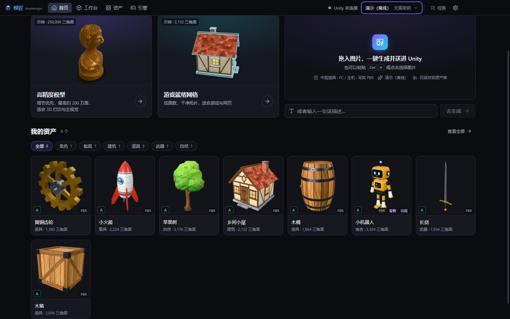

<h1 align="center">Modelwright · 模匠</h1>

<b>面向游戏开发者的 AI 3D 生成工作台：一键生成 3D 模型，直接进游戏引擎。</b> 把 AI 生成的粗坯做成能进引擎的成品——模匠。

  <a href="https://github.com/chenyihang98-pixel/Modelwright/releases/latest">下载最新版</a> ·
  <a href="https://chenyihang98-pixel.github.io/Modelwright/">介绍页</a> ·
  <a href="https://www.bilibili.com/video/BV1YqpZ6kEw4">演示视频</a> ·
  <a href="#第一次使用">第一次使用</a> ·
  <a href="#连接-unity">连接 Unity</a> ·
  <a href="#验证情况与已知限制">验证情况</a> ·
  <a href="LICENSE.txt">许可协议</a>

文字或图片进，游戏可用的模型出——本地完成减面、LOD、碰撞体、轴心与尺寸，再直接送进你的 Unity 工程。生成本身由云端服务完成（你自己的 API 密钥），本机不需要下载任何大模型权重；换一台电脑，装上应用、填入密钥即可继续工作。

> 当前版本 **0.1.19**（2026-10-28）：用一个来源明确、原本没有骨骼的标准人形（model-viewer 的宇航员，CC-BY 2.0）分别送 Tripo、Meshy、混元绑骨，三份结果独立登记、各自导入同一批 Mixamo 动作、各自导出并在 Unity 6 里保存重开、连续播放走 / 跑 / 开火 / 装填 / 倒地；Tripo 人形绑骨默认用官方推荐的 v3.0（结果被服务归一化到 1 m，应用按源尺寸还原）；Meshy 新增 T2.5 智能拓扑生成和「文字生成动作」（写一句话 → 生成片段 → 应用到绑骨，两段各自计价，第二段失败只重试第二段）；混元的绑骨只读公网链接，新增「从链接导入」并让绑骨直接用版本记下的链接；试机场和靶场共用一套输入（点画面真的锁上鼠标才开始、第一下不开火、Esc 暂停不触发返回、最小化 / 失焦即暂停），靶场新增训练设置（AI 哨兵默认关、人物无敌默认开，记住选择）；帧时间按真实帧间隔统计，暂停和最小化不再绘制；导出修了 Unity 里才看得出的重复关键帧和「一片纯白」，Unity 插件 0.1.19 修了把 Meshy 绑骨误报成「蒙皮撑大 100 倍」。付费调用每次都有记录（Tripo 50、Meshy 33、混元 30 积分）；混元绑骨 FBX 不带贴图、几何前倾，属于服务输出本身。0.1.18 做了闭环整改——左键开不了火的真因是应用自己的权限策略拒绝了鼠标锁定（现在放行，锁定被拒也照常开火）；Shift 改为按一次切换走 / 跑；默认视角不再低头；标准人形 Xbot 导入后不再被放大 94 倍（按可见蒙皮边界拟合，绑定姿势恢复加了尺寸守卫）；开火 / 装填只覆盖上身、边走边连发腿照常迈步；步幅按角色轴和实际周期数估计；冷却与帧率无关；部位控制指定侧缺失不再控制另一侧，保存失败不再报成功；只有原生动画的模型也能导出带动作的 GLB；导出的 GLB 在 Unity 6 实播（A 与赏金猎人，两次导入结果一致）。零积分；手拼路线仍缺可用人形绑定。说明见 [docs/靶场与动作导入-设计.md](docs/靶场与动作导入-设计.md) 第 7 节。0.1.17 做了角色流程整改——按一份独立审计（用真实角色离线演算）逐项复现和修：靶场 / 试机场把模型的 +Z 当正前，而这个 Tripo 角色朝 +X，所以一直横着走（现在按骨架轴自动转正）；没勾上 In Place 的 Mixamo 跑步每个循环回跳 0.68 m（现在加载时原地化）；死亡后复活旧动作还混在姿势里（新的片段播放器彻底停掉）；没点开始就被哨兵砍、读面板也掉血（现在点击画面才开始，Esc / 失焦暂停，游戏时钟冻结）；手选模型后换资产选择框误显示"跟随"；头部重定向多低了 12°（叶关节不再做方向对齐，20.8° → 8.1°）；滑步（片段按角色速度配速，行走支撑脚滑动 0.60 → 0.15 m/s）。新增：动作设计台「部位摆动」模板（某侧手臂 / 腿、头、尾在待机基础上摆，幅度 0 = 待机，已存配方可载入继续调）；「导出带动作的 GLB 文件…」（FBX 角色 + 全部片段 → 一个 GLB，重载核对骨向误差 < 1e-6°）；云转换版本继承动作文件；实测有蒙皮 / 动画就纠正标记；动作文件损坏时靶场直说原因；导入保存失败不再报成功。全程只用已有模型和动作，没有花积分。说明见 [docs/靶场与动作导入-设计.md](docs/靶场与动作导入-设计.md) 第 6 节。0.1.16 做了靶场第二轮——用户说 0.1.15 的靶场「整体很劣质、移动也不对」，先录像再查：HUD 从来没显示过（画布盖在上面，试机场同样）、A / D 左右镜像（两个游戏都是）、枪口朝后朝下、镜头贴脸。全部修掉，并把靶场做成圆形霓虹竞技场：发光网格地面、光环与灯柱、带灯条的立柱和平台、七块环靶 / 四块起落靶 / 两块移动靶 / 四个能量核心、泛光；四个哨兵机器人从边缘逼近贴身砍人（按角色身高缩放，挡在镜头前变透明），玩家有生命、倒地播 Dying、3 秒复活；自由移动时角色朝走向转身，右键或开火后面朝准星并侧移（Strafe Left / Right、后退片段），镜头跟随 / 过肩 / 放大补偿 / 遇立柱拉近；武器始终指向准星，没有持枪片段的模型由程序抬手端枪；片段角色扩到 13 个。真机：用 Claude in Chrome 从 Mixamo 下载 14 条步枪动作（FBX for Unity / Without Skin / In Place）导到 Tripo 绑骨角色，14 段 23 关节全对上，13 个角色全认出，逐状态截图核对。设计与查错记录见 [docs/靶场与动作导入-设计.md](docs/靶场与动作导入-设计.md) 第 5 节。0.1.15 做了靶场（第三人称射击靶场，七件基本体拼成的武器挂在模型手骨上，八条靶道、起落靶、移动靶、油桶、假人；按片段名认持枪待机 / 开火 / 装填 / 近战）、动作导入（Mixamo 等动作文件按关节角色重定向到任何骨架，视口 / 试机场 / 靶场直接播，烘焙进 GLB，不需要 Humanoid）、组装台第二轮（± 缩放、Q/E 转 90°、框选对齐、磁吸、贴合、从拆件面板打开时列表为空的修复）、贴图图去外轮廓线（两腿内侧黑线的根源）、三件拆法时身体穿全套服装。设计见 [docs/靶场与动作导入-设计.md](docs/靶场与动作导入-设计.md)。0.1.14 做了资产文件夹（只在数据库里，不碰磁盘；「通用」固定、「未归类」兜底；生成的部件自动归到角色的夹；卡片 ⋯ / 右键 / 选择条都有「移动到文件夹」，可拖拽；封面可换；Unity 命名多了 {Folder}）、存储把关（设置 → 资产库列出应用写盘的七处位置与大小，可清理缓存、可一键删除本机全部数据；卸载程序自动清更新器缓存与桥接目录并询问是否删数据；修了组装 GLB 一直写在系统临时目录的问题）、工作台 Ctrl+Z（手动组装与动作设计台的草稿可撤销 / 重做，提交后标记为已保存）。规则见 [docs/工作台撤销与资产文件夹-设计.md](docs/工作台撤销与资产文件夹-设计.md)。0.1.13 做了页面级回退——顶栏左上角的返回键，Esc 在没人接住它时回退一页（对话框、菜单、输入框、任务抽屉、资产页的抽屉和选择都先于回退），Alt+← 与鼠标侧键同样；回退只回页面、从不改数据（经 IPC 提交的事都不受影响），模块 / 资产 / 版本的切换不进历史栈；动作映射或密钥框里有没保存的内容时，任何离开先问一句。规则见 [docs/回退机制-设计.md](docs/回退机制-设计.md)。0.1.12 让「拆件建模」第一阶段落地——判定卡、每件两张部件图（空白人台定形体、原画定贴图）并本地自动检查（视图归位按脸的朝向、等高、脸上无线条、无杂块光晕、成对部件分组、身体侧视图要窄、非头部件无肤色）、按展示级上限生成每件并逐项量网格（封闭、壳数、面数、比例、眼带浮雕、后脑有脸、后脑波纹），以及第一版「组装」：头 / 身体 / 外层 / 鞋按 ICP 贴到整身底座，头发按头放置，尾巴等配件先转向再放到底座露出的区域，裙摆底盖去掉；组装体的工作台里可以**手动组装**——每件一行改前后 / 上下 / 左右 / 缩放 / 旋转，视口实时跟着动，按当前摆放重新组装成新版本。用真实积分在大肥鱼上跑通：头做了五次（用户在视口里抓到一颗"前后两张脸"的头，六项指标全过——由此补了三项检查和一条规矩：模型、贴图、内容三样都看，转一圈再下结论），六件生成，组装八次定下固定的放置规则，带动作的整身版送进 Unity 6 试机场 PlayMode 测试通过。Tripo 中国区 / 国际区两把密钥并存；飞边三角形和小洞的本地修复。0.1.11 修复了绑骨动画版 FBX 在视口里弓背、脸被拉歪的问题（载入时先把骨骼摆回绑定姿势）；展示 / 影视级把 Tripo 开到上限（原生 2048 上传、面数要档位上限、贴图 8192 自动用 8K），并做了两轮真实极限测试——整体生成顶配与自动分部件；结论是被遮挡的区域（刘海下的眼睛、头发下的额头）要靠分部件建模，设计草案见 [docs/拆件建模-设计.md](docs/拆件建模-设计.md)。0.1.10 新增「动作设计台」——对任何有骨骼的版本挑一个模板（待机、行走、奔跑、跳跃、挥手、鞠躬），拖几个滑块（节奏、幅度、起伏、摆臂、前倾），视口当场预览，保存后试机场直接认（设计的片段优先于文件自带的同名片段），GLB 版本可烘焙成带真正动作片段的新版本送 Unity；动作写给**关节角色**而不是某一副骨架，所以人形、四足、神经元绑定的部件骨骼共用一套模板；配套「自动关节映射」——名字提议、几何定夺（髋是脊柱与两腿的最近公共祖先，侧向轴来自左右配对或镜像对称，前向由右手系推出），扭转骨、手指、根骨不动，每根骨骼的角色和左右可改。0.1.9 内置了「试机场」——当前模型成为玩家，带格子的地面、木箱、金币，WASD 走、Shift 跑、空格跳、E 做动作，镜头跟随，左侧随时换成资产库里任何模型上场，有动作片段的按片段名自动分配待机 / 行走 / 奔跑；0.1.8 的三件新东西经过了真实检验（真实应用端到端、Unity PlayMode 测试、真实动作文件、15 个真实模型普查），修掉两个问题（绑定后的版本被标成静态；试机场画出了碰撞体凸包）并把神经元分析在真实模型上的四处判断收紧。0.1.8 的三件新东西——「神经元绑定」给非人形角色（一个球加四只手、带尾巴的四足）按网格本身找出身体和能动的部件，每个部件一个控制节点，顶点按部件绑定、按节点生成待机 / 行走 / 动作，进入即给出可计算的判定（几个可动部件 / 像人形请走服务商绑骨 / 整体一块 / 网格不封闭）；Unity 插件 0.1.8 的「试机场」：发送时勾一下，导入完成就打开带地面和跟随摄像机的测试场景，按 Play 用 WASD 走、Shift 跑；「外部动作文件」：Mixamo 等下载的动作 FBX 随 FBX 交付送进 Unity，按人形重定向播放。0.1.7 把 0.1.5 / 0.1.6 里「还没修的」四件事合在一版处理——二次元角色脸上被生成服务雕出的眼窝由本地「面部平滑」放回皮肤（后处理、Unity 导入、预览三处同一套算法，Unity 插件升到 0.1.7）；裙摆保形改为四象限辅助骨并识别空心长裙，走路时膝盖不再从裙摆穿出；混元动作 FBX 的撕裂蒙皮如实报告为问题（文件本身的绑定矩阵与层级对不上，不是导入设置能修的），验收清单不再假装通过；单图被误判成设定图时可点「不是设定图」。0.1.6 修复一张角色图被误判成「多视图设定图」的问题——抠图把图上一道浅色竖缝当成背景，把人物切成等高的两半，应用就当它是两视图设定图，「生成四视图设定图」按钮随之消失；现在相邻两块边缘几乎全程贴在一起、又都不对称的，按一张图处理。概念图对话框新增「自定义指令」：把你在说明框里写的话原样交给图像模型，以选中的图为参考改图。0.1.5 让裙子不再跟着大腿翻板（Unity 插件 0.1.5「裙摆保形」，应用预览同步）；设定图拆分 2.0（任意网格、标签、特写框、地面线，自动判断视图方向归位）和「相对视图镜像」预检；新增「展示 / 影视级」目标平台（服务商最高几何精度 + 4K 贴图 + 大面数预算，验收按此打分）；一张正面图就能让概念图服务画出姿势一致的四视图并自动拆分归位。0.1.4 修好了带动作的角色进 Play 模式就消失的问题（真实 Unity 6000.6.4f1 目视验收：待机 / 行走 / 奔跑原地播放、朝向正确）。0.1.3 把腾讯混元生 3D 整个迁到腾讯云 TokenHub（一把 API Key 用全部接口，新增 48 个预设动作和文字描述动作），应用内给每家服务加了带截图的「接入指引」；0.1.2 把 Tripo 的绑骨和动作逐项实测跑通并让带动作的角色送进 Unity 自动配好 Animator；0.1.1 修复了 Unity 6 下贴图丢失的问题并加入自动更新。哪些经过了验证、哪些还没有，见文末「验证情况与已知限制」；改动清单见 [RELEASE-NOTES.md](RELEASE-NOTES.md)。

## 演示视频

**第二集：将大肥鱼带入三次元——绑骨、三个动作、一键进 Unity**

[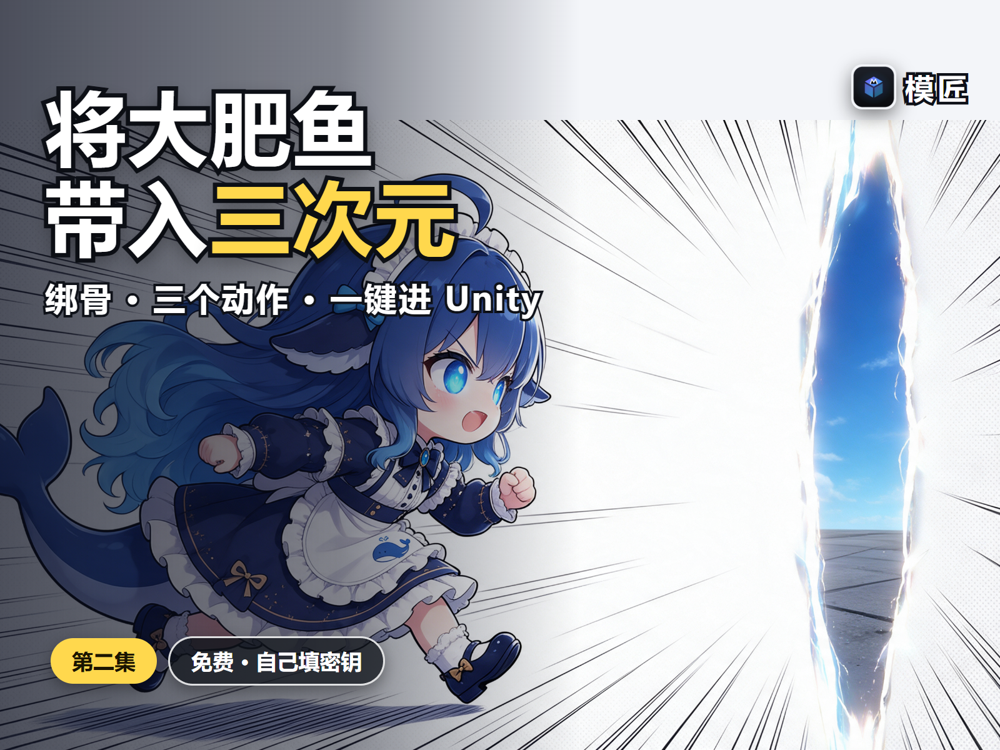](https://www.bilibili.com/video/BV1YqpZ6kEw4)

社区二创角色大肥鱼（DeepSeek 鲸鱼娘）：上集用一张设定图生成了 3D，这集在模匠里绑骨、生成待机 / 行走 / 奔跑三个动作，再一键送进 Unity 6 跑起来，星璇客串；片头是三格 AI 漫画，其余全程实录（1 分 54 秒）。B 站：<https://www.bilibili.com/video/BV1YqpZ6kEw4>（竖屏版 <https://www.bilibili.com/video/BV1t2pZ6iEqh>）

> 角色「大肥鱼 / 鲸鱼娘」为社区二创形象：原型 上善无形，DeepSeek 女仆版二设 ZipZipPipe（CC BY-NC-SA 4.0）；设定图来自「鲸鱼娘开源资产库」（github.com/TreapGoGo/deepseek-whale-girl）。视频中的 3D 模型由模匠生成，按 CC BY-NC-SA 4.0 共享，非商业用途；与 DeepSeek 官方无关。

**第一集：打破次元壁，让纸片人站进 Unity**

[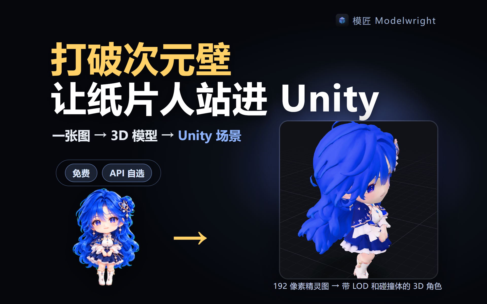](https://www.bilibili.com/video/BV1VMHU6mEQt)

一张 192 × 208 像素的桌宠精灵图，在模匠里生成、本地后处理、验收，再一键送进 Unity 6 的场景，全程实录（1 分 46 秒）。B 站：<https://www.bilibili.com/video/BV1VMHU6mEQt>

## 下载

Windows 10 / 11，64 位。三种形式任选其一，从 [Releases](https://github.com/chenyihang98-pixel/Modelwright/releases/latest) 下载：

| 文件 | 说明 |
|---|---|
| `Modelwright-Setup-0.1.19-x64.exe` | 安装版（安装向导）。默认只为当前用户安装，不需要管理员权限，可以选择安装目录；选「为所有用户安装」时 Windows 会请求管理员权限。**只有安装版会自动更新** |
| `Modelwright-Portable-0.1.19-x64.exe` | 便携版。单个文件，双击即用；设置、密钥、数据库和资产库都保存在 exe 旁边的 `Modelwright-Data` 文件夹，可以整个放在移动硬盘里带走 |
| `Modelwright-0.1.19-win.zip` | 免安装压缩包，解压后运行 `Modelwright.exe`。在 `Modelwright.exe` 旁边放一个名为 `portable.flag` 的空文件，它也会把数据保存在自己目录下的 `data` 文件夹 |

安装包**没有代码签名**：第一次运行时 Windows SmartScreen 可能提示「Windows 已保护你的电脑」，点「更多信息 → 仍要运行」即可。每个文件的 SHA-256 校验值写在对应 Release 的说明里，下载后可以核对。

### 自动更新

从 0.1.1 起，**安装版**启动几秒后会到本仓库的 Releases 检查新版本：有新版本就在后台下载，下载完在窗口顶部提示「重启后生效」，也会在下次退出时自动安装。可以在「设置 → 语言与关于」里关闭自动检查，或手动点「检查更新」。更新包同样来自 GitHub Releases，下载慢或失败时应用只记录日志，不会打扰你。便携版和 zip 不会自动更新，请回到 Releases 下载新版本。0.1.0 还没有这个功能，所以从 0.1.0 升级到 0.1.1 需要手动下载安装一次（安装到原目录即可，资产库和设置都会保留）。

## 能做什么

| 环节 | 内容 |
|---|---|
| 准备输入 | 图片自动抠图、构图、尺寸适配；拆分三视图 / 四视图设定图（任意行列网格、标签、特写框、地面线都能处理，自动判断正面 / 侧面 / 背面归位，相对视图镜像了会提醒并一键修复）；一张正面图让概念图服务画出姿势一致的四视图再自动拆分；提示词优化（可接大模型，也可离线模板）；可先出概念图再生成 3D；批量：一行一个描述，逐行自动识别资产类型并给出引擎名称，检查后一次确认、一起提交 |
| 预设 | 14 种资产类型 × 8 种目标平台 × 5 种风格，自动换算面数预算、贴图尺寸、LOD、碰撞体、轴心与真实尺寸；「展示 / 影视级」一档不按实时预算，直接要服务商的最高几何精度和 4K 贴图 |
| 命名 | 每个资产有显示名称（中文即可）和引擎名称（ASCII）。中文名称自动转写为拼音：木桶 → `MuTong`、骑士长剑 → `QiShiChangJian`；提交前可以改。Unity 里的文件夹、模型、贴图、预制体都按引擎名称和「设置 → 命名规范」命名 |
| 预检 | 花积分之前逐项检查图片、提示词、参数、费用与余额，能自动修的直接修 |
| 生成 | Tripo（V3，中国区 / 国际区两栏密钥，各自测试、各自看余额）、Meshy、腾讯混元生 3D；内置离线「演示服务」，无需密钥即可体验完整流程 |
| 后处理（本地、免费） | 减面到预算、生成 LOD 链、碰撞体、轴心与尺寸校正、Unity 贴图打包；在「资产」页可以多选后批量处理 |
| 验收 | 三道关卡逐项验收并给出 A–D 等级：生成后、本地后处理后、导入 Unity 后（由插件回传的结果判定材质、预制体、包围盒、LOD、碰撞体），每一项都说明问题和处理办法 |
| 资产库 | 版本历史、搜索（支持中文）、筛选、回收站、导出 GLB / OBJ / STL / PLY |
| 进引擎 | 一键写入 Unity 工程的 `Assets/Modelwright/`；装了插件会自动建材质、预制体（含 LODGroup 与碰撞体）并放进场景；穿裙子的角色导入时自动做裙摆保形，跑动时裙子不再跟着大腿翻起 |
| 任务队列 | 生成、后处理、发送都在后台排队执行；一次批量生成、批量后处理或批量发送在队列里是一组，可以整组停止、继续或重试失败项；应用重启后队列照常恢复 |

界面为简体中文，可在「设置 → 语言与关于」切换为英文。

## 截图

| | |
|---|---|
| 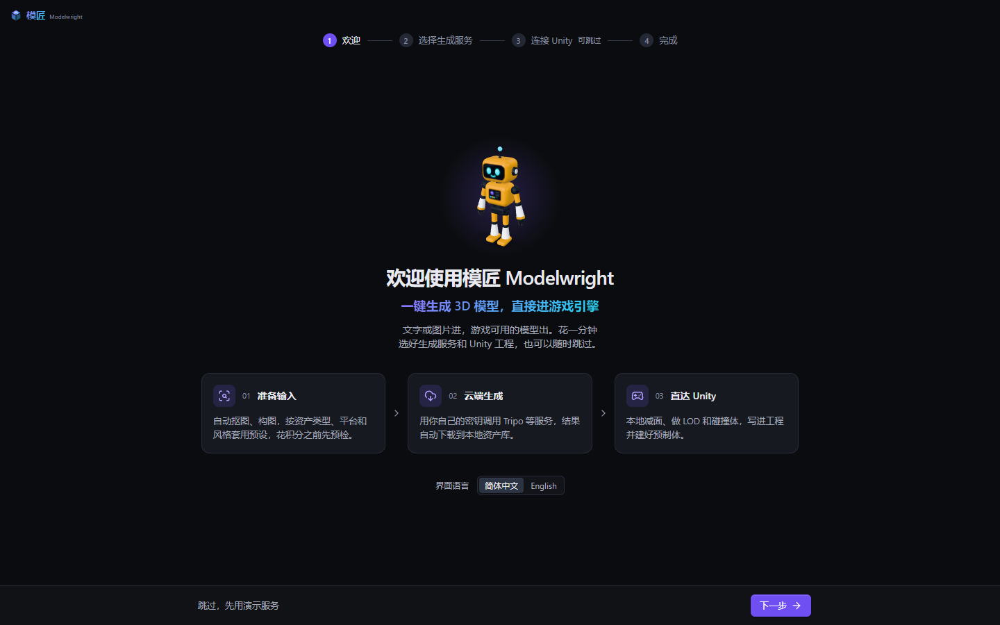 | 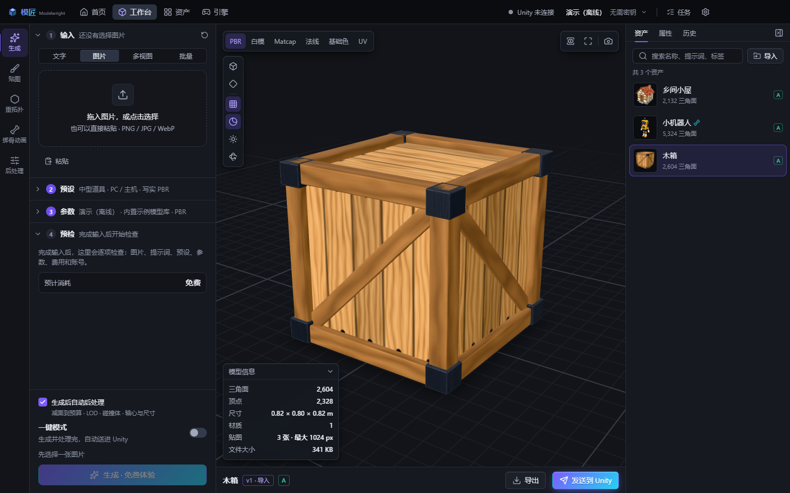 |
| 首次引导：选生成服务、连接 Unity，也可以随时跳过 | 工作台：PBR / 白模 / 法线 / UV 显示，模型信息与资产列表 |
| 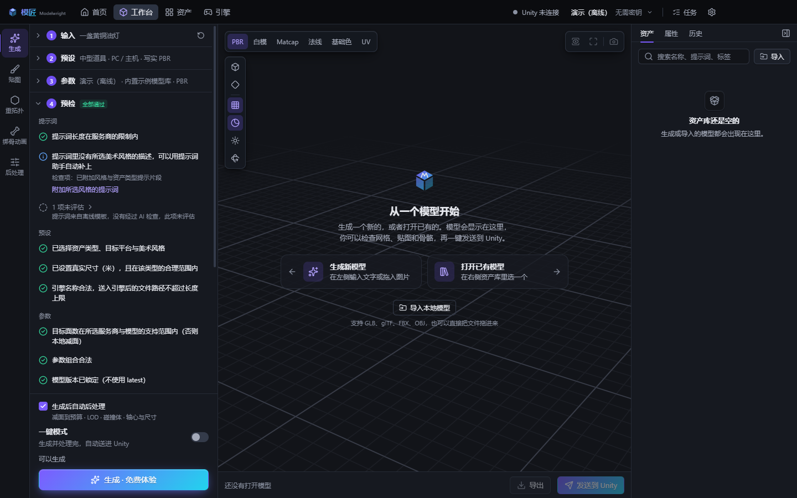 | 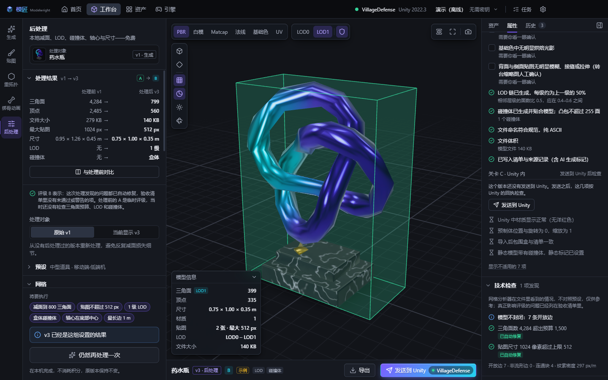 |
| 花积分之前逐项预检：提示词、预设、参数、费用 | 本地后处理：减面、LOD、碰撞体，处理前后对比与验收清单 |
| 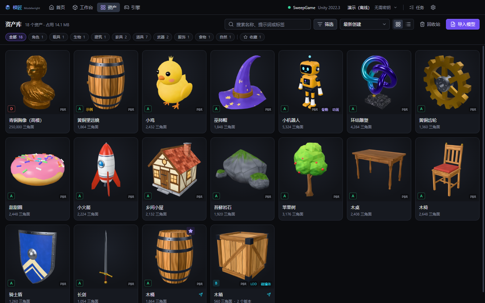 | 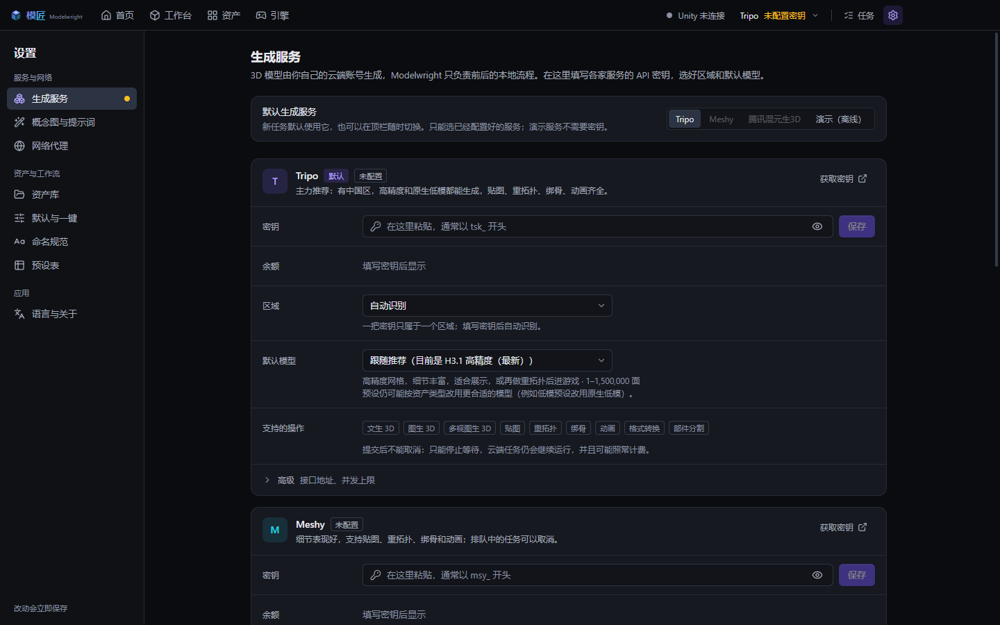 |
| 资产库：分类、评级、PBR / 骨骼 / LOD 标记、已发送标记 | 生成服务：填入你自己的密钥（Tripo 分中国区 / 国际区两栏），余额可见 |
| 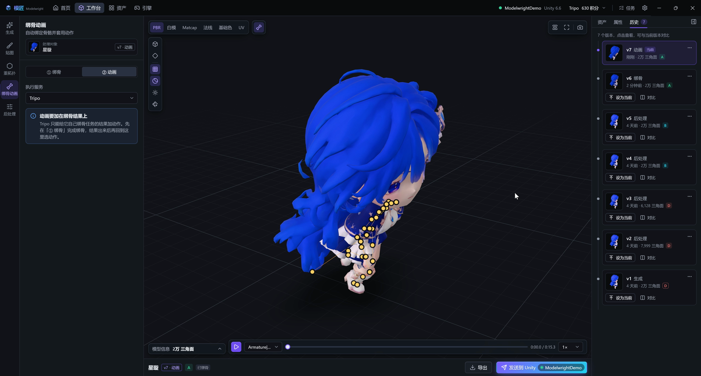 | 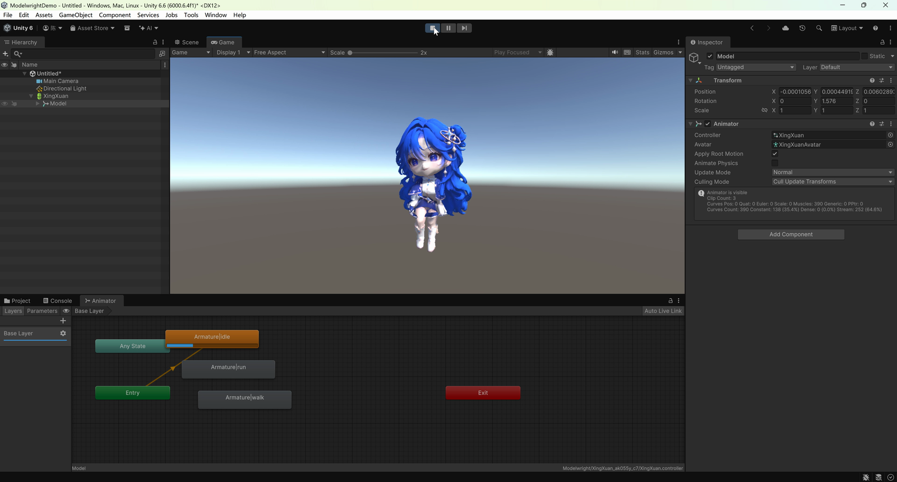 |
| 绑骨与动作：Tripo 绑骨 → 待机 / 行走 / 奔跑，应用里直接播放 | 送进 Unity 6 后按下 Play：Animator 三个状态，原地播放（0.1.4 实录） |

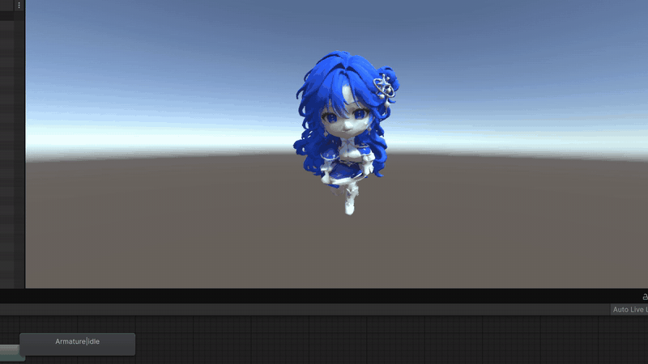

## 第一次使用

1. 打开应用会进入引导：选择生成服务。还没有密钥就选 **演示（离线）**——演示服务完全离线，返回的是内置的示例模型（不是按你的描述生成的，结果上带「示例」标记），用来走通整个流程：预设、预检、后处理、验收、送进 Unity。
2. （可选）连接 Unity：应用会列出 Unity Hub / 团结 Hub 里的工程，也可以粘贴工程的完整路径；点「安装插件」。
3. 进入首页，把一张图片拖进「拖入图片，一键生成并送进 Unity」，或者输入一句话描述。
4. 结果会出现在首页和「资产」页；在「工作台」里可以查看网格、贴图、骨骼，做后处理、导出或发送到 Unity。

### 配置真实的生成服务

设置 → 生成服务。密钥只写入、不回显，使用 Windows 的系统加密保存在本机，界面、日志和任务记录里都不会出现密钥原文。

| 服务 | 获取密钥 | 说明 |
|---|---|---|
| Tripo | 中国区 <https://developers.tripo3d.com> ／ 国际区 <https://developers.tripo3d.ai> | 推荐。两个区是两个独立账号、积分不互通，设置里各有一栏；填错栏时「测试」会提示应填到哪一栏 |
| Meshy | <https://www.meshy.ai/developers/keys> | 会员制：先订阅 Pro（或更高）会员，API 才可用；免费账号创建的密钥会被拒绝 |
| 腾讯混元生 3D（TokenHub） | <https://console.cloud.tencent.com/tokenhub/apikey> | 腾讯云 TokenHub：先在「启用管理」为 HY-3D 系列模型领取免费额度或开通后付费（按模型开通），再在「API Key 管理」创建 sk- 开头的 Key（地域选广州，访问范围「全部模型和服务」）。应用内的「接入指引」带截图 |

可选：设置 → 概念图与提示词，配置概念图服务（兼容 OpenAI 接口的各家、Tripo、Gemini）和提示词大模型（Anthropic，或兼容 OpenAI 接口的 DeepSeek / 通义 / 智谱 / 硅基流动 / Moonshot / OpenRouter / Ollama 等）。不配置也能用，只是没有概念图和智能优化。

**网络**：设置 → 网络代理，默认跟随系统代理（Clash、v2rayN 的「系统代理」模式可直接使用）。「测试连接」会逐个探测各服务地址。

**费用**：生成消耗的是你在各服务商账户里的积分。

- 提交前显示预计消耗；超过你设定的阈值必须确认，批量提交和失败任务的「重试」也一样（重试按钮上直接写着预计消耗）。
- 会计费的请求绝不自动重发。提交后没有得到服务商答复的任务（可能已经计费）会在首页顶部和「任务」上醒目提示，由你决定采用、重新提交还是放弃。
- 服务商不支持取消已经开始的云端任务时，「停止等待」之前界面会说明：它仍会在云端继续运行，并且可能照常计费。
- 金额只在应用有依据时才显示：Tripo 国际区按 $0.01 / 积分估算、混元中国站按 ¥0.12 / 积分估算，并注明是估算；Tripo 中国区、混元国际站和自定义接口地址只显示积分，不折算金额。

## 连接 Unity

支持 Unity 2022.3 LTS、团结引擎 1.x、Unity 6；Built-in / URP / HDRP。

在「引擎」页添加工程并点「安装插件」（插件是嵌入式包 `Packages/com.modelwright.bridge`，只在编辑器里运行，不进构建产物）。发送之后得到什么，取决于工程当时的状态：

| 工程状态 | 结果 |
|---|---|
| 已装插件，编辑器开着（已连接） | 立即导入：按渲染管线生成材质，做好带 LOD 和碰撞体的预制体，放进场景，并把导入结果（材质、预制体、包围盒、LOD、碰撞体）回传给桌面端，验收清单的「Unity 内」一关据此判定 |
| 已装插件，编辑器没开 | 文件先写进工程，下次打开或刷新时由插件完整导入（不放进场景，没有回执） |
| 没装插件 | 只写入文件到 `Assets/Modelwright/`，由 Unity 按默认方式导入，没有预制体 |

GLB 需要 glTF 导入器（glTFast）：工程里没有时，应用会让你选择「安装 glTFast（推荐）／云端转成 FBX／本地导出 OBJ」。带骨骼的模型在装了 glTFast 的工程里可以直接按 GLB 发送（Generic 骨架，不花积分）；需要 Humanoid 重定向时再选云端转 FBX。带动作的角色发送后，插件会在预制体旁生成一个 Animator 控制器（每个动作一个状态，idle 为默认），放进场景按 Play 就会动；你自己换的控制器不会被覆盖。桌面端和插件之间只通过本机回环地址通信，数据不离开这台电脑。

## 数据保存在哪里

| 内容 | 安装版 | 便携版（单文件 exe） | zip 版 + `portable.flag` |
|---|---|---|---|
| 资产库（模型、贴图、缩略图、输入图片） | `文档\Modelwright` | `Modelwright-Data\Library` | `data\Library` |
| 设置、密钥（已加密）、数据库 | `%APPDATA%\Modelwright\data` | `Modelwright-Data\data` | `data\data` |
| 日志 | `%APPDATA%\Modelwright\logs\main.log` | `Modelwright-Data\logs\main.log` | `data\logs\main.log` |
| 临时文件（每次启动清空） | `%APPDATA%\Modelwright\temp` | `Modelwright-Data\temp` | `data\temp` |
| 界面缓存（内置浏览器引擎） | `%APPDATA%\Modelwright` 其余 | `Modelwright-Data` 其余 | `data` 其余 |
| 更新器缓存（下载的安装包） | `%LOCALAPPDATA%\modelwright-updater` | 无 | 无 |
| Unity 桥接文件（运行时才有） | `%USERPROFILE%\.modelwright\bridge.json` | 同左 | 同左 |

「设置 → 资产库 → 存储位置」把这七处逐一列出（路径、大小、可打开），可以一键清理缓存，也可以输入 ERASE 删除本机全部数据并退出。安装版的卸载程序会自动清掉更新器缓存、桥接目录和旧的临时目录，并问两次：是否同时删除应用数据（设置、密钥、数据库、缓存），是否同时删除资产库。应用不会往这七处以外的地方写文件（发送到 Unity 工程、导出到你选的目录除外）。

资产库位置可在「设置 → 资产库」更改或整体迁移；日志可以在「设置 → 语言与关于」里直接打开。密钥用 Windows 当前账户加密：把便携版拿到另一台电脑（或另一个 Windows 账户）后，需要重新填一次密钥，其余数据照常可用。卸载安装版不会删除资产库和设置。

## 隐私与安全

- 没有自己的服务器：应用不收集、不上传你的数据；只有在你主动发起生成等操作时，相关内容才会发送给你选定的服务商。
- 密钥只存在本机，由操作系统加密；界面层永远拿不到密钥，也不直接访问互联网。
- 应用代码带完整性校验：安装目录里的程序文件被改动后应用会拒绝启动。
- 随包附带全部第三方组件的许可证全文（`THIRD-PARTY-NOTICES.txt`，也可在「设置 → 语言与关于 → 第三方许可」查看）。
- 程序未签名；请只从本页的 Releases 下载，并核对 SHA-256。

## 验证情况与已知限制

**已验证**

- 真实应用的自动化测试覆盖引导、首页一键流程、生成面板与图片处理、工作台、资产库、引擎页与发送、设置，另有七段完整的用户旅程（第一晚、从一句话开始、付费服务商、出错的情况、第二天重新打开、英文界面、二十件道具的批量）和全部界面在 1440×900 / 1100×700、中文 / 英文下的巡检。
- 付费流程用本机模拟的接口逐请求计数验证过：一次提交（包括双击、重试、批量）只发出应有的那些计费请求。
- 发布的三个文件由同一份源码构建；安装目录和便携版通过自检（含抠图引擎、网格管线、Draco 解码、第三方许可清单）。
- 用假密钥访问各服务商的真实接口：地址、TLS、鉴权失败的识别都正确（Tripo 两个区、Meshy、混元、Anthropic、Gemini）。
- **裙摆保形与大肥鱼全链路（2026-10-12，0.1.5）**：星璇在 Unity 6000.6.4f1 的 Play 模式里 idle / walk / run，裙子不再翻板（原地更新、新副本两条路径）；大肥鱼（DeepSeek 鲸鱼娘，社区角色）从三视图设定图到拆分归位、预检镜像修复、展示级生成、绑骨，验收 A；用一张正面图生成的 A 姿势四视图再生成一次，两只手都是干净的五指。
- **单图误判成设定图的修复（2026-10-13，0.1.6）**：用触发问题的两张大肥鱼 A 姿势瓦片（原图与 512 px 缩图）和五张真实设定图（鲸鱼娘资产库三视图、两张 Banana Pro 四视图、仓库自带两张）复测——瓦片不再被判为设定图，五张设定图全部仍被识别；单元测试覆盖「被竖缝切开的一张图」与「并排的两个对称道具视图」两种边界。
- **面部平滑、裙摆四象限与混元撕裂蒙皮（2026-10-13，0.1.7）：Unity 6000.6.4f1 批处理探针（插件自己的导入管线，静止 / 摆姿网格离线渲染）——大肥鱼 8 组画上去的五官找到 7 组放回皮肤、5633 个顶点移动，静止姿势渲染里眼窝消失，三个动作的包围盒不变；星璇 4 个象限辅助骨、1727 个顶点改刷；混元动作 FBX 的 skinStretch 1.67 触发警告，Tripo / Meshy 的文件无警告。预览器的面部平滑与裙摆四象限各有单元测试，「不是设定图」有端到端测试。没有在 Play 模式目视裙摆四象限的跟随角度。**
- **神经元绑定、试机场与外部动作文件（2026-10-25，0.1.8）：合成形状的单元测试（球加四手找到 4 个部件、火柴人判为人形并从脚尖判出朝向、立方体判为整体、开放片判为不封闭）；流水线写出骨骼、四级 LOD 都有权重、三段动作、glTF 校验无错误；Unity 6000.6.4f1 批处理探针导入该 GLB——4 个蒙皮 LOD、7 根骨骼、Animator 3 个状态、行走和动作时的包围盒在变；试机场打开后场景有跟随摄像机、灯光、地面和挂着控制器的角色；外部动作文件的库存与移除有单元测试。没有在真实编辑器里按 Play 走过试机场，Mixamo 的真实文件没有实测。**
- **真实检验与内置试机场（2026-10-25，0.1.9）：端到端在真实应用里导入球加四手的 GLB → 神经元分析判定 ok、4 个神经元 → 绑定 → 新版本 animated、3 段动作 → 视口动画条 → 试机场里 3 段动作、按 W 切到 walk；Unity 6000.6.4f1 PlayMode 测试打开插件的试机场场景——角色先站着、巡逻开始后 2.5 秒走了 2.43 m、Animator 处于 walk、摄像机在上方朝向角色、蒙皮包围盒随动作变化（1 项通过）；Meshy 的 Walking.fbx 作为外部动作挂到 Tripo 绑骨的星璇上，探针回执 4 段动作、MeshyWalk 状态播放时包围盒在变；10 个示例模型与 5 个真实 GLB 的分析普查（小鸡 2 条腿、椅子 / 石头 / 绳结判整体、大肥鱼呆毛不再是头）。真实检验里发现并修了两处：绑定后的版本被标成静态；试机场画出了碰撞体凸包。**
- **动作设计台与自动关节映射（2026-10-25，0.1.10）：映射 8 组骨架的单元测试（真实 Tripo 大肥鱼 41 根含扭转骨、Mixamo、混元式根骨、示例机器人、名字全乱的机器人、四足加尾巴、神经元链、用户修正），模板 12 项（独立前向运动学验证步态相位、膝盖时机、首尾闭合、跳跃起止、挥手单臂、四足对角、厘米骨架与米骨架一致），three.js 回放 3 项，流水线烘焙 4 项（glTF 校验 0 错误）；真实应用端到端——示例机器人映射 13 根为人形 → 保存 run → 试机场 4 段、Shift 用设计的 run → 烘焙出带 4 段动作的新版本；本机真实大肥鱼 Tripo FBX——映射为人形、保存 run 和 jump、试机场 5 段：W 走 Armature|walk、Shift 跑设计的 run、空格跳设计的 jump；Unity 6000.6.4f1 批处理探针导入烘焙后的机器人 GLB：导入成功、无警告、Animator 8 个状态，设计的 jump 中心高度 0.61 → 0.86 m、run 前后跨度 0.54 → 0.82 m，无 NaN。真实检验里发现并修了三处：根骨和 Pelvis 被当成部件摆动把角色掀翻、四足躯干链被判成腿、跳跃首帧肘部未归零。**
- **绑定姿势修复、生成上限与极限测试（2026-10-25，0.1.11）：绑定姿势单元测试（弓背的节点姿势经 ×0.01 的骨架节点摆回绑定姿势，本就一致的骨架不动），预设映射 29 项（展示级向服务商要档位上限、空面板不评视图数）；端到端——示例机器人的动作设计台 + 试机场、本机真实大肥鱼 Tripo FBX（站直、脸正常、空格跳稳定）；真实 Tripo 两轮极限测试——整体顶配 70 积分：1,887,300 面、8192² 贴图、59 MB，后处理不减面、质量 A；自动分部件 90 积分：15 件、每件一个壳但都有开放边、头发脸躯干切成一块、眼睛鞋尾巴手臂鱼鳍分开、15 张 8K 贴图。逐边统计证实 v1 / v5 都是开放边 0 的单一封闭壳：被遮挡区域不存在是生成方式所致，不是参数。**
- **拆件建模第一阶段（2026-10-26，0.1.12）：单元测试 3676 通过（276 个文件）；真实 Tripo 积分——大肥鱼 41 张部件图（国际区）、10 件部件模型（头五次，中国区），八次组装；头的转台 36 帧逐帧看过（一张脸、后脑干净、有耳朵），六件各 12 帧看过；组装体与整身直出版并排对照：部件本身干净，拼装靠固定规则给起点、手动组装收尾；带动作的整身大肥鱼发送到 Unity 6000.6.4f1 并放进试机场，批处理 PlayMode 测试通过（巡逻 2.435 m、Animator 处于 walk、蒙皮包围盒随动作变化）。端到端四个门禁 73 条中 72 条通过，剩 1 条是本机窗口 1103×703 的环境差异。**
- **页面级回退（2026-10-26，0.1.13）：单元测试 3686 通过（277 个文件）；端到端 back.spec 2/2 通过（页面级回退全流程、密钥草稿的离开守卫），重跑 home / settings / close-jobs / workspace / assets 88/88 通过，本机构建核对返回键、Esc、离开守卫均按规则工作。第一次在真实应用里跑就抓到一个真问题——由直接改 hash 产生的历史条目没有路由序号，离开守卫拦不住回到它的导航——已修（落到这种条目时标记为起点，图片编辑器的跳转改走路由器）。**
- **标准人形 U 的三家绑骨、三家接口更新、双场地输入与性能（2026-10-28，0.1.19）：单元测试 3816 通过、4 跳过（297 个文件）；e2e 72 条通过、1 条跳过；Unity 6000.6.4f1：三家导出各自导入（无警告）→ 场景保存、关闭、重开一致 → PlayMode 连续播放走 / 跑 / 开火 / 装填 / 倒地全部进入、无 NaN；性能（RTX 5080、2048 × 1104 窗口）：60 秒路线 p95 14.06 ms、p99 14.18 ms、无超过 50 ms 的可重复长帧，暂停 / 最小化 3 秒 0 次绘制；真机安装版 0.1.19：点一下画面只接管鼠标不开火，左键 30 → 29、按住连发，Shift 切换，Esc 暂停不返回，AI / 无敌开关即时生效且重启后保留，最小化即暂停，收起侧栏、取消最大化后准星仍在正中。没做：Tripo v3.0 的云端预设、Meshy 文生 T2.5、混元组件生成 / 独立 UV；生成路线与手拼路线留到下一版。**
- **闭环整改：真实输入、标准样本尺度、动作组合、出口到 Unity（2026-10-28，0.1.18）：单元测试 3774 通过、4 跳过（293 个文件）；e2e 3 条通过；隔离实验：Xbot 尺度（94 倍 → 1 倍）、A 回归与滑步、赏金猎人移动连发 / 装填 / 死亡复活 / Shift / 导出、大肥鱼原生出口、导出 GLB 的 Unity 探针（A 22 状态、赏金猎人两次导入一致）。真机：安装版 0.1.18 真机：点一下画面即锁定并开始，左键一次弹药 30 → 29，Shift 一次切到"奔跑"、再按切回，Esc 暂停（"已暂停 · 点击画面继续"）、点击恢复；A 的正式动作数据受控更新完成——备份后用动作设计台重新导入同一批 14 条 FBX + Soldier / Xbot GLB，25 段同名替换、无重复、无配方丢失，离开再进靶场读到 25 段。手拼路线仍缺可用人形绑定。**
- **角色流程整改（2026-10-27，0.1.17）：单元测试 3768 通过（290 个文件）；e2e cloud modules / submitted / 动作设计台 3 条通过；真实角色 + 真实 Mixamo 动作的实验用例：朝向四视图、未开始不掉血、三次死亡复活不残留、Esc 暂停、跑步原地化、头部俯仰 20.8° → 8.1°、滑步 0.60 → 0.15 m/s、部位配方保存重载、GLB 导出重载（骨向误差 < 1e-6°）再导入、组装体本地绑定（只找到尾巴，缺口如实记录）。**
- **靶场第二轮：竞技场、哨兵、真 Mixamo 动作（2026-10-27，0.1.16）：单元测试 3758 通过（288 个文件）；e2e cloud modules（含试机场与靶场）/ submitted / 动作设计台 3 条通过；真机：从 Mixamo 下载的 14 条步枪动作导到 Tripo 绑骨角色（14 段、23 个关节对上、13 个角色全认出），逐状态截图核对走 / 跑 / 侧移 / 瞄准 / 开火 / 装填 / 倒地复活 / 挥刀。查出并修了 0.1.15 的四处硬伤：HUD 被画布盖住从未显示（试机场同样）、A / D 左右镜像（两个游戏）、枪口朝后朝下、镜头贴脸。**
- **靶场、动作导入、组装台第二轮、去外轮廓线（2026-10-27，0.1.15）：单元测试 3757 通过（288 个文件）；e2e 组装台 / 撤销 / 文件夹 / 回退 / cloud modules（含试机场与靶场）/ 动作设计台（Mixamo 骨架样例导到小机器人：4 段片段、试机场 8 段、靶场认出、烘焙 8 段动画）13 条通过；真机：已绑骨的 Tripo FBX 角色导入 Soldier / Xbot 11 段（23 个关节对上），靶场各就各位；从文字出概念图 → 生成并绑骨 → Tripo 射击 / 挥砍预设 → 导入 Mixamo → 靶场开火、挥砍；大肥鱼身体用去线后的视图重做。抓到并修了三处（只导入不设计时动作文件被当空文件删掉；打到墙也算命中；Q 版角色拿真尺寸步枪）。**
- **资产文件夹、存储把关、Ctrl+Z（2026-10-26，0.1.14）：单元测试 3705 通过（280 个文件）；端到端 folders.spec 2/2、undo.spec 1/1、back.spec 2/2 通过（真实应用），回归 assets / home / settings / workspace 72 条通过 71 条（唯一失败是菜单多了一项的旧断言，已改），构建好的程序在本机真实库的隔离副本上核对了文件夹、存储位置块与 Ctrl+Z。真实库升级预演：29 个资产行数不变，「人形角色」夹自动收进 18 个相关资产。存储审计抓到一处真问题——部件组装的 GLB 一直写在系统临时目录且从不清理（本机约 892 MB）——已改写到应用自己的临时目录并在启动时清掉旧目录。**

**尚未验证——使用前请知悉**

- **Meshy 与混元的真实密钥实测（2026-10-09）**：Meshy（Pro 会员的 API 密钥）跑通了图生 3D → 自动绑骨 → 动作 → 发送到 Unity；混元（TokenHub，广州）跑通了图生 3D（hy-3d-3.1）→ 绑骨 → 预设动作 → 文字描述动作 → 格式转换 → 发送到 Unity（Humanoid Avatar 有效，Animator 自动配好）。这两条链只核对了 Unity 的回执，**Play 模式还没有目视验收**；2026-10-12 发现的混元动作 FBX 在 Unity 里放大、扭曲的问题，0.1.7 查明是文件本身的绑定矩阵与层级对不上（three.js、Unity、混元自己的转换都撕裂），不是导入设置能修的；插件现在测出撕裂就报警告、验收清单按问题处理，请改用 Tripo / Meshy 的动作版本或重新绑骨。**这两家的贴图、重拓扑、多视图和文生 3D，以及混元的极速版、3.0 低模和国际站，仍只用模拟服务测试过**，第一次使用这些功能时请先用少量积分试一次。混元的结果文件放在腾讯云 COS，部分网络下下载很慢：应用会自动重试，仍然失败时在任务队列里点「重试」即可。
- **Unity 6000.6.4f1（Unity 6.6）实测（2026-10-08）**：在真实编辑器里用安装版完整走过一遍——编辑器开着时从桌面端安装插件、安装 glTFast 6.20.0、自动连接、发送 GLB、生成材质 / 预制体（LODGroup、盒体碰撞体）并放进场景、回传结果。实测发现并已在 0.1.1 修复：Unity 6 会把贴图自动当成立方体贴图导入导致材质无贴图；同一资产重复发送会重复放置实例。2026-10-09 又用 0.1.2 把带动作的角色（绑骨 + idle / walk / run 的 FBX）发进同一个工程：插件在编辑器开着时升级到 0.1.2，Unity 为 Tripo 原生命名的骨架自动生成了有效的 Humanoid Avatar，预制体旁生成了带 3 个动作、默认 idle 的 Animator 控制器，验收清单「人形 Avatar 有效」一行写明「Animator 已配 3 个动作」。**2026-10-12 用 0.1.4 重新目视验收**：之前只核对了回执，这次真的按下 Play——0.1.2 / 0.1.3 的角色一进 Play 模式就消失（插件关掉了根运动，且单位校正后 Unity 沿用了旧缩放的 Avatar 描述），0.1.4 修掉后待机 / 行走 / 奔跑都在原地正常播放、朝向与预制体一致，全程录屏见演示视频第二集。**Unity 2022.3 和团结引擎仍只经过离线编译检查，尚未在真实编辑器中验收。**
- **真实付费密钥实测（Tripo 中国区，2026-10-09）**：图片生成一次成功。0.1.1 时两次绑骨失败，根因是桌面端把双足角色送到了只用于非人形生物的绑骨模型 v2.5。0.1.2 用真实密钥把「绑骨 → 动作」整条链逐项实测：双足角色用 v1.0 + Tripo 原生骨骼命名，idle / walk / run 等动作、一次多个动作、FBX 输出、原地播放全部成功；四足生物用 v2.5 + 四足行走动作成功；Mixamo 命名的绑骨和 v2.5 绑出的双足角色不能套 Tripo 的动作（任务错误 1004），应用会在发送前拦下。绑骨失败时仍会按静态角色继续处理，可稍后在工作台重试。注意 Tripo 结果文件走的 CDN（`openapi.cdn.tripo3d.com`）在部分网络下时通时断，应用会自动重试并显示重试次数；长时间连不上时任务会失败，网络恢复后在队列里重试即可。
- 安装版已在 Windows 11 上实际安装并运行；0.1.14 的卸载程序在本机装到临时目录再静默卸载验证过（自定义卸载段：清更新器缓存与桥接目录，静默时保留数据）。

**已知限制**

- 仅支持 Windows。只完整支持 Unity；Unreal / Godot / Blender 只预留了位置。
- 本地后处理不处理带骨骼的模型和只有 FBX 的版本；KTX2 压缩贴图无法在本地缩放。
- 本地抠图用的是小模型（u2netp），背景复杂时边缘可能带残留，图片处理窗口里可以用擦除 / 恢复画笔修正。
- 引擎名称的拼音转写按词读多音字（长剑读 Chang、重甲读 Zhong），生僻词可能读错；超过六个音节的中文描述只取末尾六个音节。名称在提交前可见、可改。
- 批量里的资产类型按关键词离线识别（武器、载具、建筑、角色、植物等）；「木桶」「宝箱」这类没有特征词的道具沿用面板当前的资产类型，审核表顶部会写明有几条是这样，可以逐行或一键统一修改。
- 演示服务返回的是内置示例模型，与你的描述无关；它只用于体验流程。
- 裙摆保形没有布料碰撞（0.1.7 起前片随抬腿掀起，走路不再穿出，但奔跑的极限帧膝盖仍可能擦到裙摆），不处理头发；发送选项里还没有它的开关。
- 神经元绑定的部件只从身体上长一层（手指、头上的耳朵并进所在部件）；紧贴身体的手臂、裙子里的腿几何上分不出来（面板会按资产类型提示）；动作是程序化摆动不是步态，脚不贴地；细于一格体素的部件会被忽略（可选「精细 96」）；既没有腿也没有粗头的模型朝向按 +Z 假定。内置试机场没有物理引擎（木箱是方块碰撞，没有坡和台阶）；真实的非人形生成模型还没有拿到手测；Mixamo 的真实下载文件没有测（用的是 Meshy 的动作文件，机制相同）。
- 动作设计台的模板是程序化摆动，不是动作捕捉：脚不贴地、没有 IK，想要更真的动作仍走服务商动作库或外部 FBX；FBX 版本的设计动作只在应用内（视口、试机场）可用，要进 Unity 请以 GLB 输出绑骨再烘焙；映射依赖"身体大致直立、左右对称"，躺着的、单腿的、多头的骨架需要手动修正。
- 极限测试只跑了一个角色、每轮一次，定的是基线不是规则；被遮挡区域不存在和"画上去的线变成浮雕"（睫毛成鳍、瞳孔成凸环、刘海在额头刻沟）这两件事这一版只是查清了，分部件建模只有设计草案，「部件补全」接口还没接入；8K 贴图与 200 万面的结果文件很大（59 MB / 104 MB），Tripo CDN 慢时一单要 20 分钟。
- 拆件建模只跑了一个角色（大肥鱼）：阈值是初值；组装的固定规则（§7c）给的是起点，头发在后脑仍有空隙、尾巴根藏在裙后，最后要在手动组装面板里摆；穿插检查、组装后减面、对组装版绑骨、部件补全（Tripo mesh/complete）、C3 / C6 检查、模具的导出和仓库都还没有。"只画一对鳍"这类小附件的部件图图像模型画不好（五次都带头），已并入头发。中国区的图像任务跑 5 分钟会被服务端判失败，部件图请走国际区。
- 回退只有页面级；任务抽屉开着时在页面上按 Esc 不回退（沿用抽屉的既定行为）；离开守卫接了动作映射、密钥输入框和手动组装三处草稿。
- 文件夹只有一级、一个资产只属一个夹；动作设计台的模板 / 滑杆 / 名称不进撤销历史；「删除本机全部数据」清不掉正在被占用的文件时会留下并记录；静默卸载一律保留数据。
- 神经元绑定的部件只从身体上长一层（手指、头上的耳朵并进所在部件）；紧贴身体的手臂、裙子里的腿几何上分不出来（面板会按资产类型提示）；动作是程序化摆动不是步态，脚不贴地；细于一格体素的部件会被忽略（可选「精细 96」）；既没有腿也没有粗头的模型朝向按 +Z 假定。内置试机场没有物理引擎（木箱是方块碰撞，没有坡和台阶）；真实的非人形生成模型还没有拿到手测；Mixamo 的真实下载文件没有测（用的是 Meshy 的动作文件，机制相同）。
- 神经元绑定的部件只从身体上长一层（手指、头上的耳朵并进所在部件）；动作是程序化摆动不是步态，脚不贴地；细于一格体素的部件会被忽略（可选「精细 96」）；既没有腿也没有粗头的模型朝向按 +Z 假定。试机场的 Play 模式走动没有在真实编辑器里按过；Mixamo 的真实文件没有实测。
- 面部平滑填平处的边缘还有些毛糙；落在肤色范围内的腮红、胡须会被当成皮肤不处理；深肤色角色暂不识别。火山方舟 Seedream 的模型 ID 需与你账号里开通的一致，不一致会返回 404，设置里可以手动填。
- 手动代理 + 用户名密码 + 明文 http 接口这一种组合下，代理刚切换后的第一个计费请求在极端情况下可能被发送两次（各真实服务都是 https，不受影响）。

## 反馈

问题、建议和权利声明请提交到本仓库的 [Issues](https://github.com/chenyihang98-pixel/Modelwright/issues)。提交问题时请附上应用版本、操作步骤和「设置 → 语言与关于」里打开的日志（日志里不含密钥）。

## 许可

本软件按 [最终用户许可协议](LICENSE.txt)（[English](LICENSE-en.txt)）授权使用，不是开源软件；源码不公开。随包分发的第三方组件按各自的许可证使用，见 [THIRD-PARTY-NOTICES.txt](THIRD-PARTY-NOTICES.txt)。Tripo、Meshy、腾讯混元、Unity 等名称为其各自权利人的商标，仅用于说明兼容性。

---

<b>English</b>

**Modelwright** is a Windows desktop workbench for game developers: text or image in, a game-ready 3D model out, delivered straight into your Unity project. Generation runs on cloud services with your own API keys (Tripo, Meshy, Tencent Hunyuan; an offline demo service needs no key); everything around the cloud call is local — input preparation, presets per asset type / platform / style, pre-flight checks and cost estimates before credits are spent, download, decimation / LOD / collider post-processing, a three-gate quality check, an asset library, and one-click delivery through a Unity editor plugin.

Download the installer, the portable exe or the zip from [Releases](https://github.com/chenyihang98-pixel/Modelwright/releases/latest) (Windows 10/11 x64; unsigned — SmartScreen may warn). The UI is Chinese first; switch to English in Settings → Language & about. Keys are stored only on your machine, encrypted by Windows; the app has no server of its own. Not yet verified: generation with a real paid key, the plugin inside a real Unity editor, and the installer's own install/uninstall flow. Licensed under the [EULA](LICENSE-en.txt); third-party components under their own licences ([notices](THIRD-PARTY-NOTICES.txt)).

